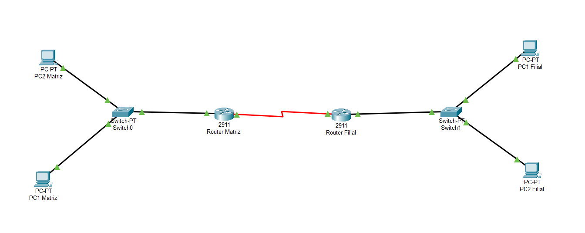
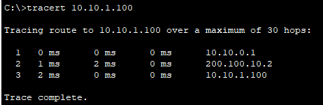
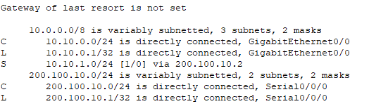

# 🌐 Interconexão de Filiais com Sub-redes IPv4 e Roteamento Estático

Projeto prático desenvolvido no **Cisco Packet Tracer** como parte do meu portfólio de infraestrutura e redes, aplicando os conceitos da certificação **Networking Basics** da Cisco Networking Academy.

## 🎯 Objetivo
Projetar, segmentar e interligar as redes locais (LAN) de uma **Matriz** e de uma **Filial** por meio de um enlace ponto a ponto (WAN), garantindo comunicação ponta a ponta com roteamento estático bidirecional e validação via CLI.

## 🏗️ Topologia da Rede

### Equipamentos Utilizados
* **2 Roteadores:** Cisco 2911 (com módulo serial HWIC-2T)
* **2 Switches:** Switch-PT (camada de acesso)
* **4 Estações de Trabalho:** PCs representando os hosts da Matriz e da Filial

## 📋 Tabela de Endereçamento IPv4

| Segmento | Rede / Máscara | Dispositivo | Interface | Endereço IP | Gateway Padrão |
| :--- | :--- | :--- | :--- | :--- | :--- |
| **LAN Matriz** | `10.10.0.0/24` | Router-Matriz | GigabitEthernet0/0 | `10.10.0.1` | — |
| **LAN Matriz** | `10.10.0.0/24` | PC-Matriz-1 | FastEthernet0 | `10.10.0.10` | `10.10.0.1` |
| **LAN Matriz** | `10.10.0.0/24` | PC-Matriz-2 | FastEthernet0 | `10.10.0.11` | `10.10.0.1` |
| **Link WAN** | `200.100.10.0/30` | Router-Matriz | Serial0/0/0 (DCE) | `200.100.10.1` | — |
| **Link WAN** | `200.100.10.0/30` | Router-Filial | Serial0/0/0 | `200.100.10.2` | — |
| **LAN Filial** | `10.10.1.0/24` | Router-Filial | GigabitEthernet0/0 | `10.10.1.1` | — |
| **LAN Filial** | `10.10.1.0/24` | PC-Filial-1 | FastEthernet0 | `10.10.1.100` | `10.10.1.1` |
| **LAN Filial** | `10.10.1.0/24` | PC-Filial-1 | FastEthernet0 | `10.10.1.101` | `10.10.1.1` |

## 🔀 Rotas Estáticas Configuradas
* **Router-Matriz:** Destino `10.10.1.0` (Máscara `255.255.255.0`) ➡️ Next-Hop `200.100.10.2`
* **Router-Filial:** Destino `10.10.0.0` (Máscara `255.255.255.0`) ➡️ Next-Hop `200.100.10.1`

## ✅ Testes e Validação

### 1. Rastreamento de Rota (`tracert`)
Comprovação do caminho completo em 3 saltos do `PC-Matriz-1` até o host `10.10.1.100` na Filial:

### 2. Tabela de Roteamento (`show ip route`)
Auditoria via terminal CLI confirmando as redes diretamente conectadas (`C`) e a rota estática (`S`):

## 📂 Como executar o projeto
1. Faça o download do arquivo `projeto2-interconexao-filiais.pkt` neste repositório.
2. Abra o arquivo utilizando o **Cisco Packet Tracer** (versão 8.0 ou superior).
